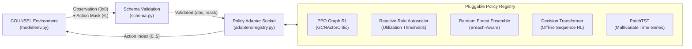

# COUNSEL MLOps Platform Guide

This repository contains the end-to-end MLOps platform for **COUNSEL**, an autonomous microservice autoscaling system. It provides pluggable policy adapters, schema-validated telemetry contracts, an offline feature store, real-time serving with LRU caching, SRE observability with drift detection, and automated DAG pipeline execution.

---

## 1. System Overview & Problem Definition

### Autoscaling Environment
COUNSEL manages cloud resource scaling for a multi-tier microservice chain (`Firewall -> WebServer -> Database`):
- **Workload Generator (`load-gen`):** Generates time-varying synthetic or trace-driven arrival rates.
- **State Telemetry:** At each control interval, the environment provides a `(3, 8)` state matrix (`24` values) and a `6`-element binary action mask representing legal VM configuration actions.
- **Decision Space:** The active policy selects an action `a \in {0..5}` corresponding to VM instance flavors (`"none"`, `"2"`, `"5"`, `"10"`, `"13"`, `"19"`).
- **Objectives:** Maintain latency within target SLO (`150 ms`) while minimizing infrastructure cost and avoiding CPU/RAM budget overruns (`[2500 CPU, 3600 GB RAM]`).

---

## 2. Pluggable Policy Architecture

The system features an interchangeable policy adapter framework (`adapters/`) with dynamic hot-swapping:



### Registered Policy Adapters
1. **`ppo` (Graph RL Baseline):** Uses a graph convolutional actor-critic network (`GCNActorCritic`) trained over 1,000 simulator epochs.
2. **`heuristic` (Reactive Threshold Controller):** Deterministic rule baseline scaling up when component utilization exceeds `80%` and scaling down below `45%`.
3. **`random_forest` (Breach-Aware Ensemble):** Dual scikit-learn classifier combining action propensity and SLO breach risk scores.
4. **`decision_transformer` (Offline RL Transformer):** Sequence modeling over trajectory tokens conditioned on target return-to-go.
5. **`patchtst` (Multivariate Time-Series Transformer):** Transformer operating on patched time-series windows of microservice telemetry.

### Switching Policies
Switching the active policy requires updating a single entry in `configs/config.yaml`:
```yaml
policy:
  active_policy: "ppo"   # Options: ppo, heuristic, random_forest, decision_transformer, patchtst
```

---

## 3. Telemetry Schema & Data Contracts (`schema.py`)

All telemetry passing into policy models or API endpoints is validated against strict data contracts:
- **Matrix Dimensions:** Enforces `(3, 8)` shape (`24` finite float values).
- **Numerical Boundaries:**
  - Adjacency matrix: `[0.0, 1.0]`
  - Normalized CPU/Memory allocations: `[-10.0, 10.0]`
  - Component utilization: `[0.0, 2.0]`
  - Traffic arrival rate: `\ge 0.0`
- **Mask Integrity:** Verifies valid binary masks and ensures the `"none"` action is never locked out.
- **Config Quoting:** Validates string literals to prevent configuration type coercion.

---

## 4. Offline Feature Store (`feature_store.py`)

- **Parquet Storage:** Telemetry transitions are materialized to `data/feature_store/offline_store.parquet`.
- **Lineage Metadata:** Automatically records SHA-256 data hashes, schema versions, row counts, and timestamps in `data/feature_store/metadata.json`.
- **Point-in-Time Splits:** Supports chronological train/validation splits (`as_of_time`) to prevent target leakage when training offline models.

---

## 5. Microservice Serving Engine (`app.py`)

- **RESTful Endpoints:**
  - `POST /predict`: Performs schema validation, checks cache, runs inference, and returns chosen VM action.
  - `POST /swap/{policy_name}`: Hot-swaps the active model in memory with zero server downtime.
  - `GET /health`: Returns service health, active policy name, and uptime.
  - `GET /metrics`: Returns throughput, P99 latency, and LRU cache hit/miss counters.
- **In-Memory LRU Cache:** Caches decisions keyed by state signature to achieve sub-millisecond response on repeated states.

---

## 6. SRE Observability & Drift Monitoring (`monitor.py`)

- **Four Golden Signals:** Tracks inference latency, traffic arrival rate, SLO breach rate (errors), and resource saturation.
- **Population Stability Index (PSI):**
  - $\text{PSI} < 0.10$: Nominal (no drift)
  - $0.10 \le \text{PSI} < 0.25$: Warning (moderate drift)
  - $\text{PSI} \ge 0.25$: Critical (significant drift; trigger retrain)
- **Artifacts:** Generates `logs/monitoring_report.json` and visualization charts in `charts/psi_drift_report.png`.

---

## 7. Pipeline DAG Orchestration (`pipeline_dag.py`)

Automates end-to-end platform workflows using a Directed Acyclic Graph:
- **Topological Sorter:** Implements Kahn's Algorithm to determine task execution order and detect dependency cycles.
- **Fault Tolerance:** Wraps step execution in exponential backoff retry logic.
- **Workflow Pipeline:**
  1. `validate_config`
  2. `extract_features`
  3. `score_policies`
  4. `monitor_drift` & `generate_model_card`
  5. `notify_summary`

---

## 8. Automated Testing & Quality Gates (`tests/test_all.py`)

Continuous integration workflow executes quality gates:
1. **Syntax & Lint Gate:** Enforces code formatting via `flake8`.
2. **Schema & Contract Tests:** Validates negative tests, NaN injection, and mask rules.
3. **Model Adapter Tests:** Asserts all 5 adapters produce compliant actions within mask constraints.
4. **Serving & Caching Tests:** Verifies state hashing and zero-downtime model swap.
5. **Drift & SRE Tests:** Validates PSI mathematical calculations against test distributions.
6. **Release Gate:** Ensures benchmark models satisfy `AverageEpRet >= 350.0` and `budget_overruns == 0`.

---

## 9. Quickstart Commands

```bash
# 1. Run schema and contract self-checks
python schema.py

# 2. Materialize offline Parquet feature store
python feature_store.py

# 3. Benchmark and evaluate all 5 policy adapters
python evaluate_swap.py

# 4. Generate SRE observability metrics and drift report
python monitor.py

# 5. Execute end-to-end DAG workflow pipeline
python pipeline_dag.py

# 6. Start model serving microservice
uvicorn app:app --host 0.0.0.0 --port 8080

# 7. Run full automated test suite
pytest tests/test_all.py -v
```

---

## 10. Contributors

- **Adarsh Reddy** ([@AdarshReddy2106](https://github.com/AdarshReddy2106))
- **Varun Sai** ([@Varun02-Sai](https://github.com/Varun02-Sai))
- **Yasin Khilji** ([@YasinKhilji](https://github.com/YasinKhilji))

